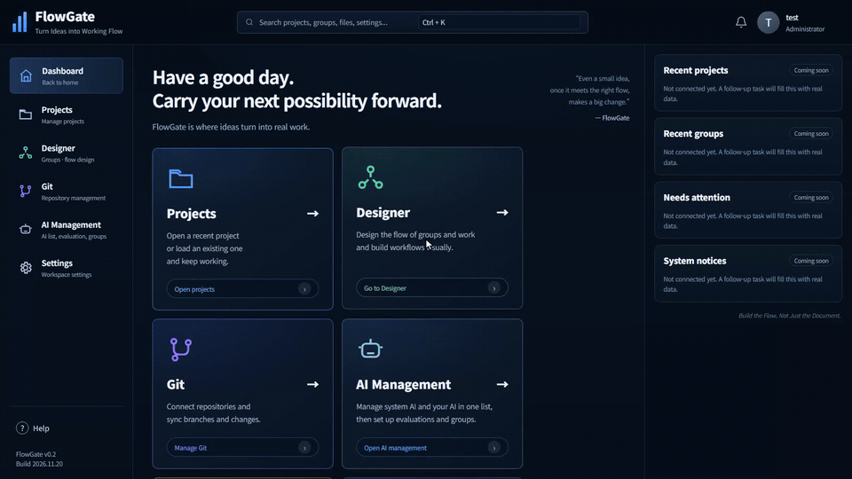

# FlowGate

**The gate between *the agent says it's done* and *it's actually done*: a v0.2 workspace for chat, visual flows, and evidence you can approve.**

[](assets/images/flowgate-demo.mp4)

## Try it (Docker)

Requires Docker with the Compose plugin. From a clone of this repository:

```bash
docker compose up -d --build
docker compose exec flowgate python create_dev_user.py \
  --username admin --email admin@flowgate.local --password 'ReplaceWithYourPassword' --admin
```

Open `http://localhost:8089/login` and sign in. The workspace lives at `/app/`; `/flowgate` is the API context, not the sign-in page. Wait for the initial database migrations before creating the admin.

## How it works

1. **Describe the work in chat.** Work with the AI to clarify requirements. Ask it to organize the work into cards; after you agree to the plan, it writes instructions and places the cards in the flow.
2. **Follow the Designer canvas.** Connected cards define dependencies, including parallel branches. Each work card carries its instructions, execution, verification, and configured review stages; AI roles and review counts can be set per card.
3. **Resolve uncertainty with Q&A.** Agents register questions against the document they are working on. Answers stay with the work instead of disappearing into an unattended terminal prompt.
4. **Inspect evidence before accepting.** Reports, changed files, and test results make completion reviewable. Review the result, request corrections, and approve or reject at the human confirmation gate.
5. **Keep source work isolated.** Git-integrated flows have their own branches and worktrees. Card results are brought together with merge and conflict handling before final acceptance.

Also included:

- Flow attachments and upload requests, alongside the conversation and card documents.
- Live status updates through Server-Sent Events and an unread notification feed.
- Multiple AI providers, including Claude Code and Codex CLI integrations, with separate execution and review assignments.

## Quick start (local, SQLite)

Requires Python 3 and Node.js. Run these commands from the repository root:

```bash
# Backend terminal
cd server
cp .env.sample .env
# Set a random SECRET_KEY, DB_TYPE=sqlite3, and CONTEXT=/flowgate in .env.
pip install -r requirements.txt
python dev.py                         # http://localhost:8088, auto-reload
```

After the server finishes migrating the database, create the first admin in another terminal:

```bash
cd server
python create_dev_user.py \
  --username admin --email admin@flowgate.local --password 'ReplaceWithYourPassword' --admin
```

Start the frontend in a separate terminal, again from the repository root:

```bash
cd client_gui
npm install
npm run dev                          # http://localhost:3001/app/
```

Sign in at `http://localhost:3001/app/login.html`. Vite proxies backend requests to port `8088`. A built client (`client_gui/build.sh`) is served by the backend: `/` and `/login` show sign-in, and `/app/` opens the workspace. Configure the keys described under Operations before enabling Agents or 2FA in a manual installation.

### Setup scripts and other databases

Run `./setup.sh` on Linux for a virtual environment, configuration, client build, systemd service, and admin setup. On Windows, `.\setup.ps1` creates the environment, builds the client, and generates `run.bat`. Both default to SQLite; Linux accepts `DB_TYPE=postgres DB_HOST=... ./setup.sh`, and Windows accepts `.\setup.ps1 -DbType postgres -DbHost ...` with the remaining database credentials.

Docker keeps SQLite, document storage, and generated secrets in the `flowgate-data` volume. For a bundled network database:

```bash
DB_TYPE=postgres docker compose --profile postgres up -d --build
DB_TYPE=mysql docker compose --profile mysql up -d --build
```

The entrypoint waits for the database; the server applies migrations at startup. Admin creation skips an existing account on subsequent runs.

## Connecting an agent

Use the **worker/chat Bearer issued for the active run**, with its bound flow ID. These graph reads do not use a user JWT or an Agent enrollment credential:

```bash
# Set FLOW_ID to the bound group ID and WORKER_TOKEN to the run's token.
curl "http://localhost:8089/flowgate/api/v2/ai/flows/$FLOW_ID/canvas" \
  -H "Authorization: Bearer $WORKER_TOKEN"
curl "http://localhost:8089/flowgate/api/v2/ai/flows/$FLOW_ID/runs/current" \
  -H "Authorization: Bearer $WORKER_TOKEN"
curl "http://localhost:8089/flowgate/api/v1/help/tools" \
  -H "Authorization: Bearer $WORKER_TOKEN"
```

The two graph endpoints only read stored state within the bound flow. Card workers are restricted to their active node and attempt; chat canvas reads default to the latest definition (`?view=revision` selects the execution definition). These reads grant no graph write, execution, or history access. The help endpoint lists the source tools available to that token; follow the returned contracts and the run's instructions for changes and reports.

## Tech & engineering

| Area | Implementation |
| --- | --- |
| Backend | Python and FastAPI; graph workflow, card lifecycle, conversations, Q&A, and scoped worker APIs |
| Database | SQLite, MySQL/MariaDB, and PostgreSQL; 190+ ordered migrations per backend |
| Frontend | Vue 3, Pinia, Vue Router, Vue Flow, Vite, and ko/ja/en localization |
| AI and Git | Configurable CLI/API providers; per-flow source workspaces, diffs, reviews, and conflict resolution |
| Validation | Backend and frontend regression suites; see [TESTING.md](TESTING.md) |
| Deployment | Docker Compose, Linux systemd, and a Windows launcher |

## Project layout

```text
FlowGate/
├── server/
│   ├── routers/                 # FastAPI wiring and client routes
│   ├── flowgate/                # card lifecycle, chat control, graph reads/policies
│   ├── modules/flow_gate/       # APIs, graph_workflow, services, auth, and database access
│   ├── sql/migrations/          # sqlite, mysql, postgres
│   └── tests/
├── client_gui/
│   ├── index.html, login.html  # workspace and sign-in entries
│   └── src/
│       ├── app/                # application shell and routing
│       ├── features/           # designer, conversation, attachmentRequests, git, settings
│       ├── login/              # sign-in UI
│       └── shared/             # transport, auth, and localization
├── Dockerfile, docker-compose.yml
├── deploy/                     # entrypoint and systemd template
├── setup.sh, setup.ps1
└── TESTING.md
```

## Operations

### Security posture and trust boundary

AI CLI integrations and configured test runners execute repository commands. Anyone who can configure or launch them has command-execution authority inside the FlowGate service account and its filesystem/container boundary. Isolate that boundary and grant only the credentials and paths it needs.

New providers keep **Skip permission confirmation** off by default. Operators must explicitly enable it. Leaving it off can pause unattended work at a CLI approval prompt; enabling it permits commands without per-command confirmation.

`FLOWGATE_AGENT_API_BASE` is the HTTP(S) origin reachable by spawned CLI workers, not the browser URL. Use an origin only, such as `http://127.0.0.1:8089` for same-host workers. If unset, FlowGate preserves an explicit operator port or uses `FLOWGATE_PORT` on loopback. Blank or malformed configured values stop CLI startup.

### Required security settings and secret backups

`ALLOWED_ORIGIN` defaults to empty: cross-origin browser requests are blocked, while the bundled same-origin client works. Set permitted origins explicitly for a separately hosted frontend.

Docker and the setup scripts generate encryption keys and peppers once. Stored provider API keys use `FLOWGATE_AI_ENCRYPT_KEY`; `FLOWGATE_AI_ENCRYPT_KEY_PREV` supports rotation. Back up the database and document storage together with the secret material:

- Docker: `$FLOWGATE_STORAGE_DIR/.flowgate-secrets.env` in `flowgate-data`.
- Local/setup installations: `server/.env`, including `SECRET_KEY`, `FLOWGATE_TOKEN_PEPPER_ACTIVE_ID`, all `FLOWGATE_TOKEN_PEPPER_*` values, `FLOWGATE_GIT_ENCRYPT_KEY`, `FLOWGATE_TOTP_ENCRYPT_KEY`, `FLOWGATE_AI_ENCRYPT_KEY`, and `FLOWGATE_AGENT_PEPPER` (plus any encryption `_PREV` keys present during rotation).
- If using automatically generated encryption key files instead of environment values, preserve the storage root containing those files too.

A database-only backup is incomplete: lost keys can make Git credentials, provider API keys, and TOTP secrets unreadable. Losing the Agent pepper invalidates registered Agent credentials; it has no `_PREV` fallback. Installers refuse to generate a replacement pepper when Agents are already registered without it: restore the original value.

## Status / Roadmap

FlowGate v0.2 is a working chat and visual-flow workspace with card execution, verification, review, and human confirmation. Its own development uses these flows. Which checks and AI reviews run depends on each card's settings.

Future direction: clearer orchestration diagnostics, deeper Git hosting integration, and broader external-agent interoperability. These are roadmap goals, not promises of currently available integrations.

## License

FlowGate v0.2 is available under the [MIT License](LICENSE) - Copyright (c) 2026 horrible-gh.
